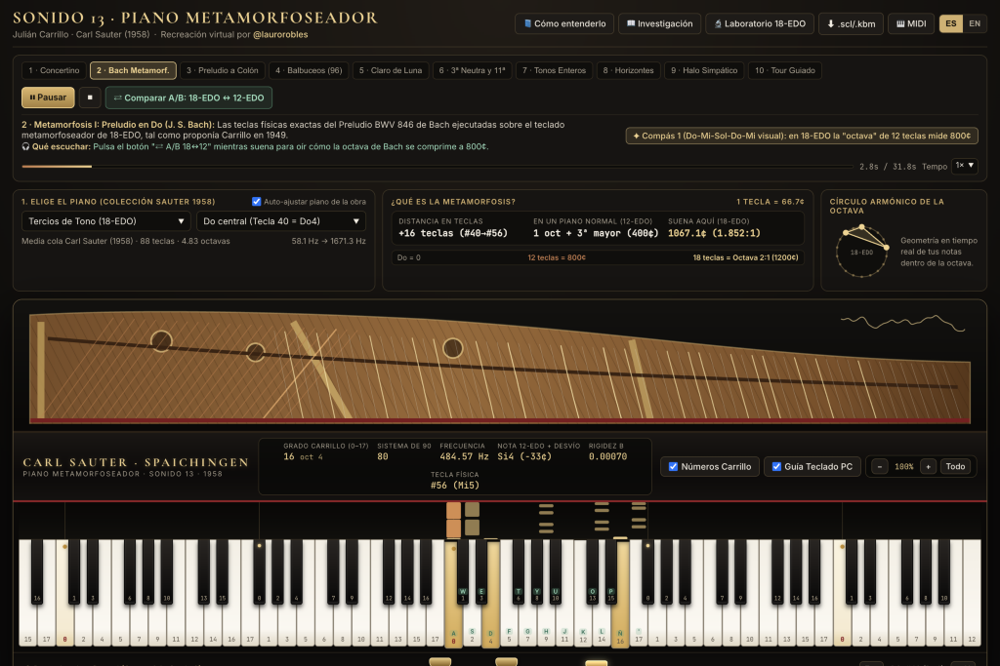

# SONIDO 13 · Piano Metamorfoseador Virtual (Julián Carrillo)

[](https://laurorobles.github.io/sonido13-piano/)
[](https://github.com/laurorobles/sonido13-piano/releases)
[](./LICENSE)

**Reconstrucción web interactiva por modelado físico híbrido** del **piano metamorfoseador de tercios de tono (`18-EDO`)**, concebido por el compositor, director y teórico mexicano **Julián Carrillo (1875–1965)** dentro de su revolución microtonal del ***Sonido 13*** y fabricado en **1958** por la manufactura alemana **Carl Sauter** (Spaichingen).

Creado por **[@laurorobles](https://www.instagram.com/laurorobles/)** · **[Abrir el instrumento en vivo →](https://laurorobles.github.io/sonido13-piano/)** · **[Leer Anexo de Investigación Completo →](https://laurorobles.github.io/sonido13-piano/investigacion.html)**

*([Read in English below ↓](#english-overview))*



> [!NOTE]
> **Transparencia organológica:** Las fuentes académicas confirman que el piano de tercios de tono construido por Carl Sauter en 1958 —presentado en la Expo 58 de Bruselas y conservado hoy en el **Centro Julián Carrillo** de San Luis Potosí— adoptó el mueble de un **media cola (*baby grand*) de 88 teclas** afinado en 18 divisiones iguales por octava (`4.8333 octavas`). Dado que los planos originales del encordado y las frecuencias límite exactas de esa unidad permanecen inéditos, esta reconstrucción incorpora **5 hipótesis matemáticas de anclaje tonal seleccionables** que recalibran en tiempo real las frecuencias y el perfil de inarmonicidad física $B(f_0)$. Consulta el estudio completo en **[`docs/INVESTIGACION.md`](./docs/INVESTIGACION.md)**.

---

## Características principales

- **Modelado físico híbrido en tiempo real (`AudioWorklet`):** Hasta **28 voces polifónicas × 10 modos inarmónicos** a frecuencia de muestreo nativa, excitador no lineal de macillo inspirado en la histéresis de Stulov, coro de cuerdas con *unison width* controlado, **resonancia simpática emergente** según la afinación activa y **tabla armónica de pícea alpina** mediante red FDN Hadamard de 4 canales (`0 runtime dependencies`).
- **Colección de 5 variantes históricas intercambiables (Carl Sauter, 1958):** Explora el media cola principal de **Tercios de Tono (`18-EDO`)**, **Cuartos de Tono (`24-EDO`)**, **Tonos Enteros (`6-EDO`, 43 teclas)**, el emblemático piano de **Dieciseisavos de Tono (`96-EDO`, 96 teclas en una sola octava)** y un **Piano Estándar (`12-EDO`)** de referencia.
- **Pianola Animada con Rollo de Notas y Comparador `A/B` en vivo:** 10 obras y estudios con cascada visual sobre el teclado, anotaciones didácticas en tiempo real y conmutador instantáneo **`⇄ Comparar A/B: 18-EDO ↔ 12-EDO`** sin detener la reproducción.
- **Herramientas pedagógicas interactivas:** **Inspector de Metamorfosis en vivo** (compara distancia en teclas vs. piano normal vs. intervalo microtonal real), **Círculo Armónico de la Octava (SVG)**, **Visor de Notación Numérica de Carrillo** (`0–17` y escala unificada de `90`), **Laboratorio Acústico 18-EDO** y exportación directa **Scala (`.scl` / `.kbm`)**.
- **Visualización física del Carl Sauter 1958 + Web MIDI + Zoom:** Arpa dorada de hierro fundido y cuerdas de cobre/acero que vibran y resuenan simpáticamente al tocar, teclado con zoom continuo (`100%–260%`), glissando, atajos QWERTY (`A–Ñ`, `Z`/`X` registro, `Espacio` sustain) e interfaz bilingüe (`ES` / `EN`).

---

## Colección de 5 variantes del instrumento

| Variante | División | Teclas | Extensión | Descripción organológica |
|---|---|---|---|---|
| **Tercios de Tono** *(Principal)* | `18-EDO` (`66.67¢`) | 88 | `4.83 oct` | Media cola (*baby grand*) Carl Sauter 1958; conserva la escala de tonos enteros y abre la 3ª neutra (`11:9`) y 11ª armónica (`11:8`). |
| **Cuartos de Tono** | `24-EDO` (`50.00¢`) | 88 | `3.63 oct` | Metamorfoseador vertical Sauter 1958; contiene el total cromático de `12-EDO` más cuartos de tono intermedios. |
| **Tonos Enteros** | `6-EDO` (`200.00¢`) | 43 | `7.00 oct` | Metamorfoseador compacto Sauter 1958; cada 6 teclas duplican la frecuencia permitiendo saltos multi-octava a una mano. |
| **Dieciseisavos de Tono** | `96-EDO` (`12.50¢`) | 96 | `1.00 oct` | Emblema del *Sonido 13* (Sauter 1958); las 96 teclas enteras despliegan una única octava (`Do4–Do5`) de micro-intervalos. |
| **Piano Estándar** | `12-EDO` (`100.00¢`) | 88 | `7.25 oct` | Referencia acústica comparativa para escuchar en un clic las *Leyes de metamorfosis* y la diferencia de halo simpático. |

---

## Hipótesis de anclaje tonal en 88 teclas (`18-EDO`)

| Configuración | Tecla de referencia | Tecla 1 (grave) | Tecla 88 (aguda) | Uso recomendado |
|---|---|---|---|---|
| **Do central** *(Por defecto)* | Tecla 40 = `Do4` (`261.63 Hz`) | `58.27 Hz` (`Si♭1`) | `1661.22 Hz` (`Sol♯6`) | Equilibrio acústico óptimo y `Do = 0` en el centro del teclado. |
| **La de concierto** | Tecla 49 = `La4` (`440.00 Hz`) | `69.30 Hz` (`Do♯2`) | `1975.53 Hz` (`Si6`) | Ideal para concertar con orquesta tradicional (como en el *Concertino*). |
| **Inicio en La1** | Tecla 1 = `La1` (`55.00 Hz`) | `55.00 Hz` (`La1`) | `1567.98 Hz` (`Sol6`) | Mantiene la primera tecla en `La`, una octava arriba del `La0` estándar. |
| **Inicio en Do2** | Tecla 1 = `Do2` (`65.41 Hz`) | `65.41 Hz` (`Do2`) | `1864.66 Hz` (`La♯6`) | Alinea la tecla 1 con el grado `Do = 0` de la notación numérica de Carrillo. |
| **Inicio en La0 estándar** | Tecla 1 = `La0` (`27.50 Hz`) | `27.50 Hz` (`La0`) | `783.99 Hz` (`Sol5`) | Hipótesis extrema de registro grave profundo. |

---

## Repertorio de 10 obras y estudios en la Pianola Animada

| # | Obra / Estudio | Piano sugerido | Enfoque histórico y acústico |
|---|---|---|---|
| **1** | **`1 · Concertino`** | `18-EDO` | Estudio concertante (*Lento – Allegro*) inspirado en la grabación de Philips (1958) con Bernard de Flavigny y Julián Carrillo. |
| **2** | **`2 · Bach Metamorf.`** | `18-EDO ↔ 12-EDO` | El *Preludio en Do mayor BWV 846* ejecutado con su digitación literal y transformado por las *Leyes de metamorfosis* (1949). |
| **3** | **`3 · Preludio a Colón`** | `24-EDO` | Evocación de la obra fundacional del *Sonido 13* (1922) con arpegios cristalinos y vocalise deslizante en cuartos de tono. |
| **4** | **`4 · Balbuceos (96)`** | `96-EDO` | Homenaje a la pieza de 1958: clústeres de batimiento lento y barrido continuo a `12.5 cents` por tecla en una sola octava. |
| **5** | **`5 · Claro de Luna`** | `18-EDO ↔ 12-EDO` | El ostinato de la Sonata Op. 27 n.º 2 de Beethoven metamorfoseado: las octavas del bajo pasan a `800¢` y la 3ª menor a `200¢`. |
| **6** | **`6 · 3ª Neutra y 11ª`** | `18-EDO` | Exploración de las consonancias armónicas puras exclusivas del `18-EDO`: tercera neutra (`11:9`) y undécima natural (`11:8`). |
| **7** | **`7 · Tonos Enteros`** | `6-EDO` (43 teclas) | Cascadas impresionistas sobre el metamorfoseador de tonos enteros donde 6 teclas completan la octava. |
| **8** | **`8 · Horizontes`** | `24-EDO` | Coral contemplativo a 4 voces con conducción cromática interna en movimiento contrario de `50 cents`. |
| **9** | **`9 · Halo Simpático`** | `18-EDO ↔ 12-EDO` | Experimento acústico de pedal: contrasta la resonancia limpia de octavas y décimas del `18-EDO` frente a las quintas del `12-EDO`. |
| **10** | **`10 · Tour Guiado`** | `18-EDO` | Recorrido didáctico paso a paso por los 18 grados, la escala de tonos enteros interna y los acordes del sistema. |

---

## Documentación del proyecto

| Documento | Contenido |
|---|---|
| **[Manual de Usuario Interactivo (`docs/MANUAL.md`)](./docs/MANUAL.md)** | Guía completa de operación, reglas de la metamorfosis musical, referencia de las 5 variantes y 5 anclajes, guía de las 10 piezas, calibración física, exportación Scala y Web MIDI. |
| **[Investigación Histórica y Acústica (`docs/INVESTIGACION.md`)](./docs/INVESTIGACION.md)** | Monografía completa sobre el piano Carl Sauter de 1958, física del `18-EDO` en `4.83` octavas, inarmonicidad $B$, resonancia simpática, comparativa de familias de síntesis y bibliografía citada. |
| **[Anexo Documental Web (`public/investigacion.html`)](./public/investigacion.html)** | Edición tipográfica autónoma con índice navegable y formato listo para impresión/PDF, accesible desde el propio instrumento. |
| **[Arquitectura y Especificación DSP (`docs/ARCHITECTURE.md`)](./docs/ARCHITECTURE.md)** | Diagrama del sistema, grafo `AudioWorklet`, ecuaciones del banco modal inarmónico, excitador de macillo, matriz simpática y red FDN de tabla armónica. |
| **[Hoja de Ruta VST3 / AU / CLAP (`docs/ROADMAP_VST.md`)](./docs/ROADMAP_VST.md)** | Plan técnico en 5 fases para portar el motor a C++20 / JUCE 8 con vectorización SIMD, cliente ODDSound MTS-ESP y soporte MPE / MIDI 2.0. |
| **[Historial de versiones (`CHANGELOG.md`)](./CHANGELOG.md)** | Registro detallado de cambios por versión. |

---

## Instalación y desarrollo local

Requiere **Node.js 20+**:

```bash
git clone https://github.com/laurorobles/sonido13-piano.git
cd sonido13-piano
npm install
npm run dev      # Inicia servidor de desarrollo en http://localhost:5173
npm run build    # Compila TypeScript y genera el paquete estático en dist/
```

---

## English Overview

**Sonido 13 · Virtual Metamorphoser Piano** is an interactive, browser-based hybrid physical modeling reconstruction of **Julián Carrillo’s third-tone metamorphoser piano (`18-EDO`)**, built in **1958** by German piano maker **Carl Sauter** (Spaichingen) and preserved today at the Centro Julián Carrillo in San Luis Potosí, Mexico.

- **Play it live in your browser:** https://laurorobles.github.io/sonido13-piano/ (click **`EN`** in the top-right bar to switch the entire interface, live didactic callouts, and guides to English).
- **Hybrid physical modeling engine (`AudioWorklet`):** 28-voice modal string bank with 4.83-octave inharmonicity curve $B(f_0)$, velocity-dependent nonlinear hammer exciter, tight 3-string unison beating, EDO-authentic sympathetic string resonance, and a 4-channel Hadamard FDN Alpine spruce soundboard—with zero runtime dependencies.
- **5 Sauter 1958 piano variants + 10 animated Pianola works:** Switch seamlessly between `18-EDO` (88-key baby grand), `24-EDO` (quarter-tones), `6-EDO` (43-key whole-tone), `96-EDO` (96-key single-octave sixteenth-tone), and `12-EDO` standard reference, complete with live `A/B` metamorphosis comparison, Scala `.scl/.kbm` export, and **Web MIDI**.

---

## Cómo citar / Citation

Si utilizas este instrumento virtual o su documentación en investigación académica, docencia o producción artística, puedes usar el botón **"Cite this repository"** en GitHub (generado desde [`CITATION.cff`](./CITATION.cff)) o la siguiente referencia:

> Robles, L. (`@laurorobles`). (2026). *Sonido 13 · Piano Metamorfoseador Virtual: Reconstrucción por modelado físico híbrido del piano de tercios de tono de Julián Carrillo* (v1.0.0) [Software]. https://github.com/laurorobles/sonido13-piano

---

## Créditos y licencia

- **Investigación aplicada, diseño e implementación virtual:** Lauro Robles ([@laurorobles](https://www.instagram.com/laurorobles/)) · [@extasisrecords](https://extasisrecords.bandcamp.com)
- **Concepción teórica e instrumento histórico original:** Julián Carrillo Trujillo (1875–1965) y Pianofortefabrik Carl Sauter (Spaichingen, 1958).
- **Licencia:** Distribuido bajo la licencia [MIT](./LICENSE).
