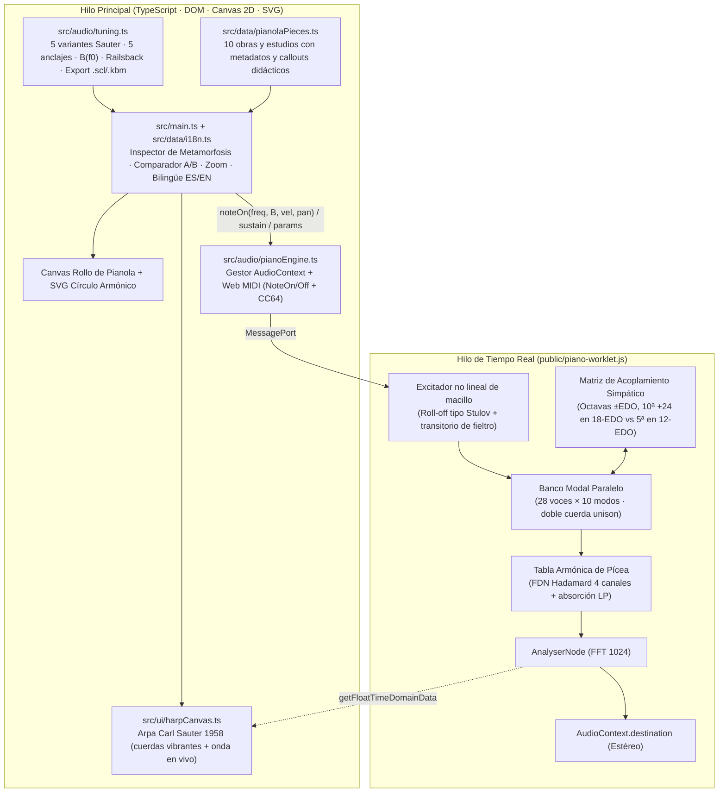

# Arquitectura Técnica y Especificación DSP · Sonido 13 Piano Virtual

**Sonido 13 · Piano Metamorfoseador Virtual** está construido en TypeScript estricto y `Web Audio API` (`AudioWorklet`) con **cero dependencias en tiempo de ejecución (`0 runtime dependencies`)**, separando de manera limpia la capa matemática de afinación e inarmonicidad, el motor de síntesis física muestra por muestra en el hilo de audio y la visualización organológica en `Canvas 2D` / `SVG`.

---

## 1. Diagrama general del sistema



---

## 2. Estructura de directorios

```text
sonido13-piano/
├── index.html                    # Entrada principal + SEO / Open Graph / Schema.org JSON-LD
├── package.json                  # Configuración del paquete (TypeScript + Vite, 0 deps runtime)
├── tsconfig.json                 # Configuración estricta ES2022
├── vite.config.ts                # Base dinámica para desarrollo local y GitHub Pages
├── CITATION.cff                  # Metadatos académicos de citación
├── CHANGELOG.md                  # Historial detallado de versiones
├── LICENSE                       # Licencia MIT
├── .github/workflows/
│   └── deploy.yml                # CI/CD automático hacia GitHub Pages
├── public/
│   ├── piano-worklet.js          # Procesador DSP en tiempo real (Sonido13PianoProcessor)
│   ├── investigacion.html        # Anexo documental académico completo con TOC e impresión
│   ├── og-preview.png            # Imagen social para Open Graph / X / WhatsApp
│   ├── robots.txt                # Directivas para motores de búsqueda
│   └── sitemap.xml               # Mapa XML del sitio
├── docs/
│   ├── INVESTIGACION.md          # Monografía musicológica, organológica y psicoacústica
│   ├── MANUAL.md                 # Manual ilustrado de usuario y guía del repertorio
│   ├── ARCHITECTURE.md           # Este documento
│   ├── ROADMAP_VST.md            # Plan de ingeniería hacia VST3 / AU / CLAP (JUCE 8 + C++20)
│   └── images/
│       └── sonido13-screenshot.png
└── src/
    ├── main.ts                   # Estado global, teclado 88/43/96, Pianola, Inspector, A/B y eventos
    ├── styles.css                # Diseño visual del mueble Sauter, marfil/ébano, latón y paneles
    ├── audio/
    │   ├── tuning.ts             # Geometría N-EDO, 5 anclajes, curva B(f0), Railsback y Scala
    │   └── pianoEngine.ts        # Envoltorio Web Audio + Web MIDI
    ├── data/
    │   ├── pianolaPieces.ts      # Generadores algorítmicos y partituras de las 10 obras
    │   └── i18n.ts               # Diccionario bilingüe ES/EN, Guía rápida y resumen histórico
    └── ui/
        └── harpCanvas.ts         # Renderizador 60 fps del arpa Sauter, tabla de pícea y cuerdas
```

---

## 3. Modelo matemático y algoritmos DSP

### 3.1 Frecuencias microtonales y curva de inarmonicidad $B(f_0)$
Para una división igual de la octava en $N$ partes (`N-EDO`, con $N \in \{6, 12, 18, 24, 96\}$) anclada en la tecla $k_{\text{ref}}$ de frecuencia $f_{\text{ref}}$, la frecuencia fundamental base de la tecla $k$ es:

$$
f_{\text{base}}(k) = f_{\text{ref}} \cdot 2^{(k - k_{\text{ref}}) / N}
$$

Sobre $f_{\text{base}}$ se aplica una compensación cúbica suave de estiramiento de octavas (*Railsback*) escalable por el usuario. A continuación, el coeficiente físico de rigidez mecánica $B(f_0)$ modela un media cola alemán compacto (~165–185 cm):

$$
B(f_0) = \operatorname{clamp}\!\left(0.00013 + 0.00022\left(\frac{f_0}{261.63}\right)^{1.54} + B_{\text{entorchado}}(f_0),\; 0.00012,\; 0.025\right)
$$

En `18-EDO` (con `Do4` en la tecla 40, rango `58.27 Hz – 1661.22 Hz`), $B$ permanece acotado entre `~0.00018` y `~0.00373`, evitando la inarmonicidad extrema (`~0.01842`) del `Do8` en un piano de `12-EDO`.

### 3.2 Banco modal paralelo con rotación fasorial acoplada
Cada una de las **28 voces** instancia hasta $M = 10$ modos parciales acotados estrictamente por debajo de $0.44 \cdot f_s$ para garantizar **cero aliasing**:

$$
f_n = n \cdot f_0 \sqrt{1 + B_{\text{ef}} \cdot n^2}, \qquad n = 1, \dots, M
$$

Cada modo se integra mediante un resonador complejo de rotación acoplada (numéricamente estable incluso a frecuencias bajas y altos factores $Q$):

$$
z_n[t] = r_n \cdot e^{j \omega_n} \cdot z_n[t - 1], \qquad \omega_n = \frac{2\pi f_n}{f_s}, \qquad r_n = \exp\!\left(\frac{-6.907755}{T_{60}(n) \cdot f_s}\right)
$$

Una segunda cuerda acoplada por modo opera con una razón de desafinación $\delta$ proporcional a `unisonWidth` y acotada inversamente con el registro agudo, generando el **decaimiento en dos etapas** propio del coro de piano acústico sin comprometer la inteligibilidad de los intervalos de `66.67 cents`.

### 3.3 Excitador no lineal de macillo y punto de golpeo
La amplitud inicial $A_n$ de cada parcial combina la ventana espacial del punto de impacto ($x_0 \approx L / 7.5$) con una ley de caída espectral gobernada por la velocidad de ataque $v$ y la dureza del fieltro $H$ (aproximación modal de la compresión con histéresis de Stulov):

$$
A_n = \frac{v \cdot \left(0.28 + 0.72\,|\sin(\pi n x_0)|\right)}{n^{\,\gamma(v, H)}}, \qquad \gamma(v, H) = 2.4 - 1.35\,(0.45 H + 0.55 v)
$$

Se suma además un breve transitorio exponencial ($\tau \approx 4.5\text{ ms}$) que aporta el chasquido mecánico del macillo sobre el acero.

### 3.4 Acoplamiento simpático dependiente del EDO
Cuando una nota se percute, `exciteSympathetic()` inspecciona todas las voces cuyos apagadores están levantados (`held || sustained`) e inyecta energía en sus modos fundamentales y de octava únicamente cuando existe coincidencia interválica física real:
- En **`18-EDO`**: octavas exactas (`±18`, `±36` pasos) y décima mayor / tercera mayor armónica (`+24`, `+6` pasos), suprimiendo por completo las quintas inexistentes.
- En **`12-EDO`**: añade los acoplamientos clásicos de quinta justa y duodécima (`+7`, `+5`, `+19` pasos), permitiendo comprobar de oído la diferencia de transparencia del pedal.

### 3.5 Tabla armónica FDN Hadamard de 4 canales
La suma de fuerzas en el puente alimenta una red **Feedback Delay Network (FDN)** con cuatro retardos coprimos ($\{11.3, 14.9, 19.7, 25.1\}\text{ ms}$), filtros paso-bajos de primer orden que emulan la disipación interna de la madera de pícea y una matriz ortogonal de mezcla **Hadamard $\frac{1}{2}\mathbf{H}_4$**, seguida de una etapa suave de saturación `Math.tanh` para evitar recortes digitales en pasajes *fortissimo* con pedal.

---

## 4. Diseño libre de basura en tiempo real (Zero-GC Audio Thread)

Todos los arreglos tipados (`Float32Array`) de las 28 voces y de los 4 retardos FDN se reservan **una sola vez** en el constructor de `Sonido13PianoProcessor`. Durante `process()`, no se instancia ningún objeto, cierre ni arreglo temporal, manteniendo una latencia determinista sin pausas del recolector de basura de JavaScript.
