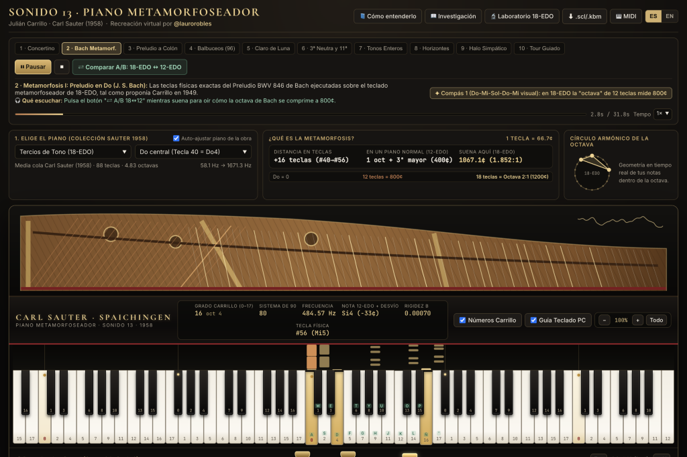

# Manual de Usuario y Guía Interactiva · Sonido 13 Piano Metamorfoseador

Bienvenido a **Sonido 13 · Piano Metamorfoseador Virtual**, reconstrucción interactiva en navegador del piano de tercios de tono (`18-EDO`) concebido por **Julián Carrillo (1875–1965)** y fabricado por **Carl Sauter** en 1958.

*Figura 1: Vista completa del instrumento mostrando la barra de 10 obras y estudios, el inspector de metamorfosis en vivo, el círculo armónico de la octava, el arpa abierta Carl Sauter de 1958, el rollo de pianola animado y el teclado de 88 teclas.*

---

## Índice rápido

1. [Inicio rápido en 60 segundos](#1-inicio-rápido-en-60-segundos)
2. [Cómo entender la «Lógica Metamorfoseadora»](#2-cómo-entender-la-lógica-metamorfoseadora)
3. [Colección de los 5 pianos Sauter (1958) y 5 anclajes](#3-colección-de-los-5-pianos-sauter-1958-y-5-anclajes)
4. [Guía de la Pianola Animada y las 10 obras incluidas](#4-guía-de-la-pianola-animada-y-las-10-obras-incluidas)
5. [Herramientas educativas en vivo](#5-herramientas-educativas-en-vivo)
6. [Calibración física del arpa y macillos](#6-calibración-física-del-arpa-y-macillos)
7. [Teclado, Zoom, Web MIDI y exportación Scala (`.scl/.kbm`)](#7-teclado-zoom-web-midi-y-exportación-scala-sclkbm)

---

## 1. Inicio rápido en 60 segundos

1. **Toca directamente:** Haz clic o arrastra (glissando) sobre las teclas de marfil y ébano, o usa el teclado de tu computadora (`A` a `Ñ`). El motor `AudioWorklet` se inicia automáticamente en tu primer gesto.
2. **Escucha la Pianola Animada:** Elige cualquiera de las **10 obras** en la cinta superior (`1 · Concertino` a `10 · Tour Guiado`) y pulsa **`▶ Reproducir`**. Verás caer las notas en el rollo superior, vibrar las cuerdas correspondientes del arpa Sauter y aparecer comentarios explicativos en tiempo real (`✦`).
3. **Experimenta la Metamorfosis con un clic:** Mientras suena **`2 · Bach Metamorf.`** o **`5 · Claro de Luna`**, pulsa el botón verde **`⇄ Comparar A/B: 18-EDO ↔ 12-EDO`**. Escucharás al instante cómo la misma digitación pasa del sistema temperado clásico al espacio microtonal de Carrillo sin detener la música.
4. **Cambia de idioma o abre el Anexo:** Usa **`ES` | `EN`** arriba a la derecha para alternar todo el instrumento entre Español e Inglés, o abre **`📖 Investigación` → `Abrir Anexo de Investigación Completo`** para consultar el estudio académico íntegro.

---

## 2. Cómo entender la «Lógica Metamorfoseadora»

Julián Carrillo conservó deliberadamente el **teclado tradicional de teclas blancas y negras** para que cualquier pianista pudiera emplear su técnica habitual mientras el instrumento **transforma geométricamente los intervalos** (*Leyes de metamorfosis musicales*, 1949):

| Gesto físico en el teclado | En un piano estándar (`12-EDO`) | En el piano de tercios de tono (`18-EDO`) |
|---|---|---|
| **1 tecla contigua** | Semitono (`100 cents`) | **Tercio de tono (`66.67 cents`)** |
| **3 teclas** *(3ª menor visual)* | Tercera menor (`300 cents`) | **Tono entero exacto (`200.0 cents`)** |
| **5 teclas** *(4ª justa visual)* | Cuarta justa (`500 cents`) | **Tercera neutra (`333.3 cents` ≈ `11:9`)** |
| **6 teclas** *(tritono visual)* | Tritono (`600 cents`) | **Tercera mayor exacta (`400.0 cents`)** |
| **8 teclas** *(6ª menor visual)* | Sexta menor (`800 cents`) | **Undécima armónica (`533.3 cents` ≈ `11:8`)** |
| **12 teclas** *(octava visual)* | Octava (`1200 cents`, `2:1`) | **Dos tercios de octava / 6ª menor (`800.0 cents`)** |
| **18 teclas** *(9ª aumentada visual)* | Octava + tritono (`1800 cents`) | **Octava real `2:1` (`1200.0 cents`)** |

> **Pista visual en el teclado:** Todas las teclas marcadas con un **punto dorado superior y número `0` en carmesí** indican el regreso al grado **`Do = 0`** (es decir, cada **octava real `2:1`**).

---

## 3. Colección de los 5 pianos Sauter (1958) y 5 anclajes

En el panel **`1. Elige el Piano`**, puedes conmutar entre cuatro instrumentos representativos de la célebre serie de **15 pianos metamorfoseadores Carl Sauter (1958)** más un piano de referencia:

1. **`Tercios de Tono (18-EDO)`:** Mueble de media cola (*baby grand*) de 88 teclas (`4.83 octavas`). Es el instrumento central de esta investigación.
2. **`Cuartos de Tono (24-EDO)`:** Mueble vertical de 88 teclas (`3.63 octavas`, `50¢` por paso).
3. **`Tonos Enteros (6-EDO)`:** Mueble vertical compacto de **43 teclas** (`7.0 octavas`, `200¢` por paso).
4. **`Dieciseisavos de Tono (96-EDO)`:** Emblema del *Sonido 13* con **96 teclas** dedicadas a **una sola octava** (`Do4–Do5`, `12.5¢` por tecla).
5. **`Piano Estándar (12-EDO)`:** Referencia acústica de `7.25 octavas` con resonancias simpáticas de quintas y cuartas tradicionales.

Para `18-EDO` y `24-EDO`, el selector contiguo permite elegir cualquiera de los **5 puntos de anclaje tonal** (*Do4 en tecla 40*, *La4 en tecla 49*, *Inicio en La1*, *Inicio en Do2* o *Inicio en La0*), recalculando al vuelo tanto las frecuencias como la rigidez física $B(f_0)$ de cada cuerda.

---

## 4. Guía de la Pianola Animada y las 10 obras incluidas

Al mantener activada la casilla **`Auto-ajustar piano de la obra`**, cada pieza selecciona automáticamente el piano histórico para el que fue concebida:

- **`1 · Concertino` (`18-EDO`):** Dos secciones contrastantes (*Lento misterioso* y *Allegro metamórfico*) que muestran la cantabilidad en pasos de `66.7¢` y el brillo armónico de las octavas de 18 teclas.
- **`2 · Bach Metamorf.` (`18-EDO`):** Ejecuta literalmente las teclas del *Preludio BWV 846*; ideal para alternar el botón **`⇄ Comparar A/B`**.
- **`3 · Preludio a Colón` (`24-EDO`):** Evoca el ambiente camerístico de 1922 con líneas melódicas deslizantes de cuarto de tono.
- **`4 · Balbuceos (96)` (`96-EDO`):** Demuestra cómo 24 teclas recorren apenas una tercera menor, generando batimientos lentos y un glissando continuo de una octava a través de las 96 teclas.
- **`5 · Claro de Luna` (`18-EDO`):** Reinterpreta la Sonata Op. 27 n.º 2 de Beethoven bajo las leyes de metamorfosis.
- **`6 · 3ª Neutra y 11ª` (`18-EDO`):** Destaca los intervalos `11:9` (`+5` pasos) y `11:8` (`+8` pasos).
- **`7 · Tonos Enteros` (`6-EDO`):** Aprovecha las 7 octavas del teclado de 43 teclas en cascadas impresionistas.
- **`8 · Horizontes` (`24-EDO`):** Coral polifónico con movimiento contrario de `50¢`.
- **`9 · Halo Simpático` (`18-EDO`):** Mantiene pisado el pedal sobre `Do3` y percute armónicos agudos en *staccato* para hacer audible la respuesta simpática pura del arpa.
- **`10 · Tour Guiado` (`18-EDO`):** Exposición pedagógica paso a paso.

---

## 5. Herramientas educativas en vivo

- **Visor de Notación en el Atril:** Muestra para la última nota pulsada el **Grado Carrillo** (`0` a `EDO−1`), su equivalencia en el **Sistema unificado de 90 divisiones** (`0, 5, 10... 85`), la **Frecuencia exacta en Hz**, la **Nota 12-EDO más próxima con desviación en cents**, el coeficiente de **Rigidez $B$** y el **número de tecla física**.
- **Inspector `¿Qué es la Metamorfosis?`:** Analiza cualquier par de notas consecutivas o los extremos de un acorde activo.
- **Círculo Armónico de la Octava:** Representa cada clase de altura sobre un reloj circular (`Grado 0` a las 12 en punto) y traza polígonos geométricos para visualizar la simetría de tríadas, acordes neutros y escalas de tonos enteros.
- **Modal `🔬 Laboratorio 18-EDO`:** Permite audicionar aisladamente los cuatro intervalos clave del sistema con un clic.

---

## 6. Calibración física del arpa y macillos

| Control | Rango | Función acústica en el modelo físico |
|---|---|---|
| **Dureza de macillo** | `10% – 100%` | Modela la rigidez del fieltro (ley no lineal tipo Stulov): valores bajos producen un timbre íntimo de cámara; valores altos excitan parciales superiores e impacto percusivo. |
| **Anchura de unísono** | `0% – 100%` | Ajusta la micro-desafinación del coro de cuerdas por tecla. Calibrada al `35%` por defecto para conservar el decaimiento doble sin empastar los tercios de tono agudos. |
| **Resonancia simpática** | `0% – 100%` | Controla la transferencia de energía en el puente hacia cuerdas libres cuando el pedal de resonancia está activo. |
| **Rigidez de cuerda ($B$)** | `0.0× – 2.0×` | Escala la inarmonicidad física $f_n = n f_0 \sqrt{1 + B n^2}$. En `0.0×` las cuerdas son idealmente flexibles; en `1.0×` siguen la curva de acero de un media cola Sauter compacto. |
| **Curva Railsback** | `0.0× – 1.5×` | Aplica estiramiento psicoacústico de octavas coherente con la inarmonicidad del registro. |
| **Tabla de pícea (FDN)** | `0% – 100%` | Mezcla la radiación cuerpo/madera generada por la red Hadamard de 4 retardos con absorción paso-bajos. |

---

## 7. Teclado, Zoom, Web MIDI y exportación Scala (`.scl/.kbm`)

- **Zoom del teclado (`100%` a `260%`):** Usa `-`, `+` o **`Todo`** en la esquina derecha del atril para ver las 88/96 teclas enteras de un vistazo (`100%`) o ampliar una región para tocar cómodamente con ratón o pantalla táctil.
- **Atajos de teclado de computadora:**
  - `A W S E D F T G Y H U J K O L P Ñ` → Toca 18 teclas cromáticas consecutivas a partir del registro activo.
  - `Z` / `X` → Desplaza el registro activo `−12` / `+12` teclas hacia graves o agudos.
  - `Barra espaciadora` → Pedal derecho de **Resonancia / Sustain**.
  - `Shift` → Pedal izquierdo **Una Corda** (suaviza velocidad y dureza del fieltro).
- **Soporte Web MIDI (`🎹 MIDI`):** Conecta cualquier teclado controlador USB-MIDI; la nota `MIDI 21 (La0)` mapea a la Tecla `#1` y el pedal `CC64` controla la resonancia simpática.
- **Exportación Scala (`⬇ .scl/.kbm`):** Descarga con un clic el par de archivos `.scl` y `.kbm` exactos de la variante y anclaje activos para cargarlos directamente en **Modartt Pianoteq**, **Surge XT**, **Vital**, **Kontakt** o cualquier sintetizador microtonal en tu DAW.
